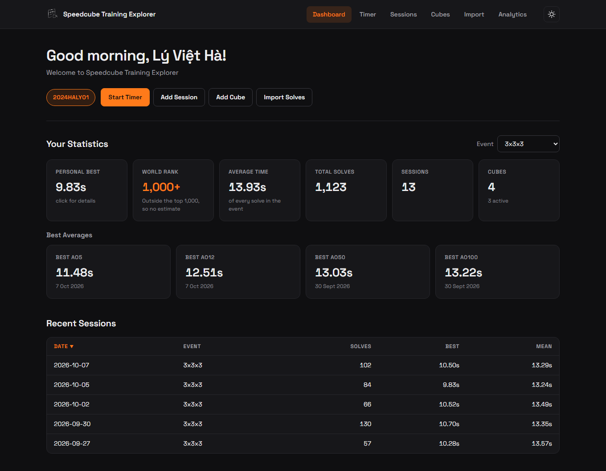

# Speedcube Training Explorer 🎲

**Track your progress. Analyse your solves. Compare with the world.**

A training tracker for speedcubers that runs on your own computer and opens in your web
browser. Time your solves, analyse your progress with charts, keep track of your cubes, and
see how you stack up against the WCA world rankings. Everything is stored on your computer,
and a double-click (or one command) starts it.




---

## ✨ Features

### 📊 Dashboard

- **Personal Bests:** your best single for every event you've logged, with its date and scramble
- **World Rank:** where your best single would rank in the WCA world rankings, with its
  percentile, for every ranked timed event (One-Handed and the blindfolded events included). The
  rankings list the fastest 1,000 people in each event, so a slower single shows as outside the
  top 1,000 rather than a guess
- **At a Glance:** your average, total solves, sessions and cubes
- **Recent Sessions:** your latest sessions, sortable by any column
- **Quick Actions:** jump straight into the timer, or add a session or cube

### ⏱️ Live Timer

- **Competition-Style Timing:** hold the space bar until the time turns green, let go to
  start, and press again to stop
- **WCA Inspection:** an optional 15 second inspection that follows the WCA rules: starting
  after 15 seconds is a +2, and after 17 a DNF. The 8 and 12 second calls show on screen, and
  can also beep or be spoken
- **Scrambles:** a new 25 move 3x3x3 scramble for every solve. They're random-move, as the
  WCA's own were in its 2006 Regulations, rather than random-state like official WCA scrambles
  today, so they mix the cube well for practice but aren't exactly like competition ones
- **Live Statistics:** solve count, best, mean and Ao5 for the whole session as you solve
- **A Session a Day:** your first solve each day starts a new session automatically
- **Penalties:** mark any solve as +2 or DNF afterwards
- **Cancel Any Time:** press Esc to call off inspection or a solve without saving it
- **Fullscreen Mode:** hides everything except the scramble and the time
- **Settings That Stick:** inspection, its sound, and hiding the timer or stats are saved with
  your data, so they're the same next time, in any browser, and in your backups

### 🗂️ Sessions and Cubes

- **Sortable Tables:** click any column heading (date, time, solves and so on) to sort by it,
  and click again to reverse the order
- **Every Solve:** open a session to see all its solves, sorted however you like, even if it
  holds tens of thousands
- **Add by Hand:** create sessions and add solves yourself
- **Cube Inventory:** record each cube's type, brand, model and when you got it, and link cubes
  to sessions

### 📈 Analytics

- **Scores:** Speed, Consistency and Overall, each the percentage of WCA competitors in the
  same event that your session beats (using official results from the last two years, bundled
  with the app so it works offline). Colour-coded from red (needs work) to green (excellent),
  with how they've changed recently. [How the scores are worked out](docs/SCORES.md)
- **Insights:** plain-English tips on what to work on next
- **Charts:** progress over time, time distribution, rolling Ao5 and Ao12, and consistency across
  sessions, for a whole event or a single session

### 📥 Import and Backup

- **CSTimer Import:** bring in your existing CSTimer sessions (JSON or TXT export), choosing
  which ones to import. Every solve keeps its own date, penalty, and comment, sessions keep
  their CSTimer names, and each one can be split into a session per day. Importing the same
  file again only adds solves that aren't already there.
- **Backup and Restore:** export all your data to one JSON file, or restore from one

### 🎨 Look and Feel

- **Clean and Simple:** a calm layout with an orange accent and the Space Grotesk font
- **Dark Mode by Default:** switch to light mode with one click; the app remembers your choice
- **Personalised Greeting:** add your WCA ID and the app greets you by name
- **Fast with Big Histories:** long lists load a page at a time, so even tens of thousands of
  solves stay quick
- **Works Offline:** everything except the WCA rank and name lookup works without internet
- **No Accounts:** nothing to sign up for, and your data never leaves your computer

### 📏 Statistics the WCA Way

- **Averages:** Ao5 and Ao12 drop your best and worst results and average the rest. A DNF
  counts as your worst result, so one DNF is dropped, but two or more make the average a DNF.
- **Penalties:** a +2 is added to the solve's time everywhere it counts: PBs, means,
  averages, charts and the world rank comparison.

---

## 🚀 Quick Start

1. **Install uv**, a small free tool that sets up Python and everything the app needs. You
   only do this once; see [INSTALLATION.md](INSTALLATION.md#-1-install-uv) for the one-line
   installer.
2. **Download this project:** on GitHub, click **Code**, then **Download ZIP**, and unzip it.
3. **Start the app** in whichever of these two ways you prefer. Both work on Windows, Mac and
   Linux, and do exactly the same thing:
   - **Double-click the launcher for your system** in the project folder: **Start on
     Windows**, **Start on Mac** or **Start on Linux**. On Windows, the first start also adds
     a **Speedcube Training Explorer** shortcut with the app's icon, which starts it with no
     window at all. Put it on your desktop if you like.
   - **Or type one command** in a terminal opened in the project folder:

     ```bash
     uv run app.py
     ```

The app opens in your browser. 🎉 The first start takes a few seconds while uv gets everything
ready; after that it's quick. When you're done, close the app's browser tab and it stops by
itself. The first time you open a downloaded launcher, your system may ask you to confirm it;
[INSTALLATION.md](INSTALLATION.md#-3-start-the-app) walks through each system step by step.

---

## 🆕 What's New

- **Start with a double-click.** Every system has its own launcher (**Start on Windows**,
  **Start on Mac**, **Start on Linux**), and on Windows the app adds a shortcut with its icon
  that opens it with no window at all. Typing `uv run app.py` still works too.
- **Stops by itself.** Close the app's last browser tab and it shuts down a few seconds later,
  so there's no terminal to keep open.
- **Scores that mean something.** Speed and Consistency now show the percentage of WCA
  competitors in the same event that your session beats, based on official results from the
  last two years. Speed is measured the way the WCA ranks each event, and Consistency is
  measured in a way that doesn't mistake improvement for inconsistency. The old Accuracy score
  is gone. See [How the Analytics Scores Work](docs/SCORES.md).
- **A session a day.** The timer starts a new session with your first solve of each day.
- **Cancel with Esc.** Changed your mind during inspection, or even mid-solve? Press Esc and
  nothing is saved.
- **Runs on your computer, not just in the browser.** The older browser-only version (2.x)
  kept your data inside the browser, so clearing your browsing data (or switching browsers)
  could lose it. Now a small server on your computer saves everything to one file,
  `data/speedcube.db`. It's easy to back up, and it doesn't matter which browser you use.
- **Quick with huge histories.** Importing tens of thousands of solves no longer slows the app
  down: long lists load a page at a time, and stats are worked out by the database.
- **Sortable tables.** Every table of sessions, solves and cubes sorts by any column.
- **Charts are part of Analytics.** One tab now has your scores, insights and charts, all
  driven by the same event menu.
- **A fresh look.** Dark mode by default, an orange accent, the Space Grotesk font, and a
  simpler layout.
- **More accurate statistics.** Ao5 and Ao12 follow the WCA rules for DNFs, and +2 penalties
  are counted in your PBs, means and charts. Stats for your existing sessions are recalculated
  automatically.
- **Fully offline.** The fonts and the charting library are bundled with the app, so only the
  WCA rank and name lookup need the internet.

### Bringing Your Data Across from the Browser-Only Version

1. Open your old copy of the app (the 2.x `index.html`) and click **Export backup** in the footer
2. Start this version (see [Quick Start](#-quick-start))
3. Click **Import backup** in the footer and choose the file from step 1

---

## 📖 Usage Guide

### First Time

1. Start the app (see [Quick Start](#-quick-start)). It opens in your browser.
2. **Optional:** click **Set up WCA ID** on the dashboard to get a personalised greeting.
3. Start tracking: use the timer, add sessions by hand, or import your CSTimer data.

### Using the Timer

1. Open the **Timer** tab. (3x3x3 is the only event with a timer so far.)
2. Just start solving. The timer keeps one session per day: your first solve of the day
   starts a new session automatically (with the same cube as your last one), and the rest of
   the day's solves go into it. To add solves to an older session instead, pick it from the
   menu; choose **+ Create New Session** to split a day into more than one session.
3. Press the **space bar** to start inspection (if it's turned on). The countdown shows the
   seconds left, with calls at 8 and 12 seconds. From 15 seconds it shows +2, and at 17 the
   attempt is a DNF, as in a WCA competition.
4. Hold the **space bar** until the time turns green.
5. Let go to start solving.
6. Press the **space bar** again to stop.

Changed your mind? Press **Esc** during inspection (or even mid-solve) to cancel. Nothing is
saved, and you keep the same scramble for your next try.

Every solve is saved automatically. The list shows your latest 50 solves; use the menu next to
a solve to mark it +2 or DNF, and the gear icon for timer settings.

### Reading Your Analytics

1. Open the **Analytics** tab and pick an event.
2. The three cards show your **Speed**, **Consistency** and **Overall** scores: the percentage
   of WCA competitors in that event your recent sessions beat. Under each score is the figure
   behind it from your latest session, such as your typical Ao5.
3. The arrows show whether your last 10 sessions are better or worse than the 10 before them,
   and the insights suggest what to work on.
4. Use the **Charts for** menu to narrow the charts down to a single session.

[How the Analytics Scores Work](docs/SCORES.md) explains exactly how each score is worked out.

### Importing CSTimer Data

1. **In CSTimer:** open the Export menu and download your data as JSON or TXT.
2. **In Speedcube Training Explorer:**
   - Open the **Import** tab
   - Click **Choose File** and pick your export
   - Click **Preview Sessions**
   - Tick the sessions you want and choose which event they're for
   - Leave **Split each CSTimer session into one session per day** ticked to match the
     timer's session a day, or untick it to keep each CSTimer session whole
   - Click **Import Selected**

The picker shows each session's CSTimer name, its solves, and the days they span. Every solve
keeps the date and time you did it, its penalty, and its comment (as a note), so your charts and
history line up with the solves you time here. Solves already in the app are skipped, so you can
safely import a newer export of the same sessions: only the new solves are added.

### Managing Sessions

- **See all sessions:** the Sessions tab lists your training; pick an event to narrow it down
- **Sort:** click a column heading to sort by it, and click again to reverse
- **See every solve:** click **View** on a session, then **Show more** to load further solves
- **Add solves by hand:** click **Add Session**, then **View** to add individual solves
- **Delete:** remove sessions or single solves you don't want

### Backing Up Your Data

Everything lives in one file, `data/speedcube.db`. Copying that file somewhere safe (while the
app isn't running) is a complete backup. You can also use the **Export backup** link in the
footer to download everything as one JSON file, and **Import backup** to restore it. See
[INSTALLATION.md](INSTALLATION.md#-where-your-data-lives) for more.

---

## 🔒 Security

The app has no accounts or passwords. Instead, it relies on only being reachable from your own
computer: the server only listens on `127.0.0.1`, so nothing else on your network can connect to
it.

That still leaves one way in: the websites you visit. Any page open in your browser can try to
send requests to `127.0.0.1`. A hidden form could post a "backup" that replaces all your data
(this is called cross-site request forgery), and a website could even point its own address at
your computer so its page can read the app's replies (DNS rebinding). So the app checks every
request:

- **The address** must be `127.0.0.1` or `localhost` on the app's own port, which rules out
  DNS rebinding.
- **Requests from other websites** to the app's data are refused. Browsers say where each
  request comes from.
- **Anything that changes your data** must come from the app's own page, and carry a header
  that a form or script on another website can't send.
- **The page itself** only runs the app's own scripts (a strict Content-Security-Policy), so
  text from an imported file could never run as code, even if a bug let it through.

None of this needs any setup, and you can still open the app in as many tabs or browsers as you
like.

---

## 🛠️ Tech Stack

- **Backend:** Python with [Flask](https://flask.palletsprojects.com/), started by
  [uv](https://docs.astral.sh/uv/). It's a small server that only accepts connections from
  your own computer, and refuses requests from other websites (see [Security](#-security)).
- **Storage:** SQLite (`data/speedcube.db`). Nothing leaves your machine.
- **Frontend:** plain JavaScript, HTML and CSS, with no build step, framework or bundler.
- **Charts:** [Plotly.js](https://plotly.com/javascript/), bundled with the app.
- **Font:** [Space Grotesk](https://github.com/floriankarsten/space-grotesk), bundled with the app.
- **External APIs (optional):** the official WCA API to look up your name from your WCA ID,
  and the [Unofficial WCA Public API](https://wca-rest-api.robiningelbrecht.be/) for world
  rankings. The WCA has no official rankings API; this community project is built from the
  WCA's own results export, and the WCA's developer documentation points people to it. These
  are only used for the world rank and the name lookup. Everything else works offline.
- **WCA results summary:** the Analytics scores compare with a summary of official results
  from the [WCA results export](https://www.worldcubeassociation.org/export/results), which is
  bundled with the app (see [docs/SCORES.md](docs/SCORES.md)).

---

## 📁 Project Structure

```text
speedcube-training-explorer/
├── Start on Windows.bat   # Double-click to start on Windows
├── Start on Mac.command   # Double-click to start on a Mac
├── Start on Linux.sh      # Double-click to start on Linux
├── app.py                 # The app itself; `uv run app.py` starts it on any system
├── pyproject.toml         # Python version and dependencies (uv.lock pins exact versions)
├── speedcube/             # The Python backend
│   ├── __init__.py        # Creates the Flask app and serves web/
│   ├── api.py             # The JSON API the web page talks to (/api/...)
│   ├── db.py              # SQLite tables, connections, and core data operations
│   ├── stats.py           # Ao5/Ao12 rules and chart maths
│   ├── scores.py          # The Analytics scores (see docs/SCORES.md)
│   ├── wca_reference.json # Summary of WCA results the scores compare against
│   ├── wca.py             # WCA rank and percentile, and WCA ID lookup
│   ├── security.py        # Keeps other websites out (see Security)
│   ├── validation.py      # Checks what the page sends before it's stored
│   ├── events.py          # The events the app knows about
│   ├── cstimer.py         # Reading CSTimer exports
│   └── backup.py          # JSON backup export and restore
├── web/                   # The web page, served by the backend
│   ├── index.html
│   ├── css/               # Stylesheets
│   ├── js/
│   │   ├── config.js      # API address, event names, and shared helpers
│   │   ├── ui.js          # Toasts and the "are you sure?" window
│   │   ├── tables.js      # Sortable table headings
│   │   ├── backup.js      # Export and import backup links
│   │   ├── dashboard.js, sessions.js, cubes.js, timer.js,
│   │   │   import.js, analytics.js, charts.js, greeting.js,
│   │   │   app.js, theme.js, theme-init.js   # One file per tab or feature
│   ├── images/            # Logo, favicon, and the shortcut icon (app-icon.ico)
│   └── vendor/            # Bundled Plotly.js and Space Grotesk (with their licences)
├── tools/
│   └── build_wca_reference.py  # Rebuilds wca_reference.json from a WCA results export
├── docs/
│   ├── SCORES.md          # How the Analytics scores are worked out
│   └── screenshots/       # Images used in this README
├── tests/                 # Automated tests (pytest), with small synthetic fixtures
│   └── e2e/               # A browser smoke test (Playwright), run on request
├── .github/workflows/     # Runs the tests on GitHub for every push and pull request
├── data/                  # Your database (created on first start, never committed)
├── Speedcube Training Explorer.lnk  # Windows only: made on first start, never committed
├── LICENSE
└── README.md, INSTALLATION.md
```

---

## 🤝 Contributing

Contributions are welcome! Whether you're a speedcuber with feature ideas or a developer who'd
like to help, we'd love to have you. Fork the repository on GitHub, make your changes on a new
branch, and open a pull request.

Feel free to open an issue for bugs or feature requests too.

### Running the Tests

The tests use [pytest](https://docs.pytest.org/) and run on temporary databases, so they never
touch your own data or need the internet. From the project folder:

```bash
uv run pytest
```

A browser smoke test also clicks through every tab in Chromium, using
[Playwright](https://playwright.dev/python/). It's left out of the everyday run because it's
slower and needs a browser download. To run it, download the browser once, then run the tests
marked `e2e`:

```bash
uv run --group e2e playwright install chromium
uv run --group e2e pytest -m e2e
```

GitHub Actions runs both on Windows, macOS, and Ubuntu for every push and pull request.

---

## 🙏 Acknowledgements

- **[Unofficial WCA Public API](https://wca-rest-api.robiningelbrecht.be/)** by
  [Robin Ingelbrecht](https://github.com/robiningelbrecht): the community-run rankings API
  this app relies on, built from the official WCA results export
- **WCA:** the World Cube Association, for their official database, results export and rankings.
  The Analytics scores use the results export: this information is based on competition
  results owned and maintained by the World Cube Association, published at
  <https://worldcubeassociation.org/results> as of September 30, 2026.
- **CSTimer:** for the inspiration and the export format
- **Plotly.js:** for the interactive charts
- **Space Grotesk:** by Florian Karsten, the font the app uses
- **Claude Code:** occasional help along the way

---

## 📝 Licence

This project is released under the MIT License. See the [LICENSE](LICENSE) file for details.
The bundled Plotly.js (MIT) and Space Grotesk (SIL Open Font License) keep their own licences,
included in `web/vendor/`.

---

Happy cubing! 🎲✨
