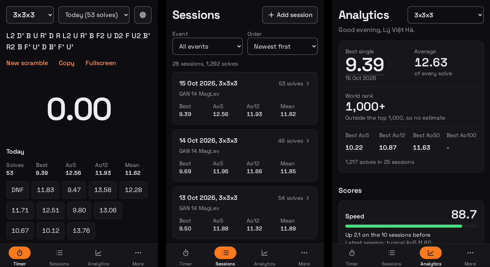
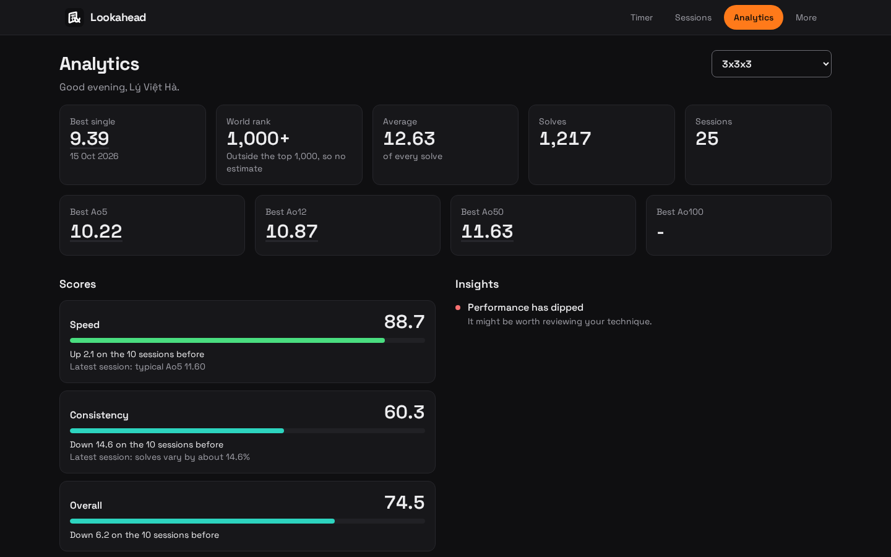

#  Lookahead 🎲

**Track your progress. Analyse your solves. Compare with the world.**


Named after **lookahead**, the speedcubing skill of finding your next pieces while you're still
solving the current ones, so you can solve without pauses. It's one of the most useful skills to
train, and this app helps you track that training. Formerly Speedcube Training Explorer.

Lookahead is a speedcubing timer and training tracker that you add to your phone's Home Screen
(or install on a computer), at **https://havl-code.github.io/lookahead/**. It works offline,
keeps your solves on your own device, and needs no account. On a computer or a wide tablet it
has the wide layout, which uses the width, with the tabs along the top.





---

## 🚀 Get Started

1. Open https://havl-code.github.io/lookahead/ on your phone or computer.
2. Add it to your Home Screen: in Safari on iPhone, tap **Share**, then **Add to Home Screen**;
   in Chrome, choose **Install app**.
3. Time a solve. That's all.

Coming from the desktop app (3.x), the 2.x browser version, or CSTimer?
[INSTALLATION.md](INSTALLATION.md#-2-bring-your-solves-across) shows how to bring your solves
across.

---

## ✨ Features

### ⏱️ Timer

- **Competition-style timing:** touch the time to inspect, hold until it turns green, let go to
  start, and touch anywhere to stop. On a computer or an iPad with a keyboard, the space bar
  does the same. Everything but the time hides while you solve, and the screen stays on.
- **WCA inspection:** an optional 15 seconds, with a +2 from 15 seconds and a DNF at 17
  (Regulations A4d1 and A4d2), and calls at 8 and 12 seconds that can beep or be spoken. The
  blindfolded events have none, as in competition (B1a).
- **Eleven events:** every cube from 2x2x2 to 7x7x7, 3x3x3 One-Handed, 3x3x3, 4x4x4, and 5x5x5
  Blindfolded, and Megaminx.
- **Scrambles:** a new one for every solve: 25 moves for 2x2x2 and 3x3x3, 40 for 4x4x4, 60 for
  5x5x5, 80 for 6x6x6, and 100 for 7x7x7 (with wide turns such as Rw and 3Rw). They're
  random-move, the lengths the WCA itself used. Official scrambles for 2x2x2 to 4x4x4 are
  random-state today, so these mix the cube well for practice but aren't exactly like
  competition ones; the WCA still scrambles 5x5x5 to 7x7x7 with random moves. Blindfolded
  scrambles end by turning the cube to a random orientation, as the WCA's do, and Megaminx
  scrambles are 70 moves in seven lines, written the way the WCA writes them.
- **A session a day:** your first solve each day starts a new session. The menu beside the
  event picks an older session to add to, and **+ New session** starts another for today.
- **Penalties, notes, and Undo:** mark a solve OK, +2, or DNF, add a note, or delete it, and
  **Undo** puts it back.
- **Shortcuts:** Alt+1, Alt+2, and Alt+3 (or Ctrl) make your last solve OK, +2, or DNF, Ctrl+Z
  (Cmd+Z on a Mac) deletes it, and Escape calls off an attempt.
- **Fullscreen:** shows only the scramble and a larger time, until Escape or Exit fullscreen.
- **Long solves:** a solve can run for up to 2 hours. Past 60 minutes (the WCA's longest time
  limit) a notice says so, and at 2 hours the timer stops and saves a DNF, as a judge does when
  a solve reaches its time limit.

### 🗂️ Sessions and Cubes

- **Every session,** for one event or all of them, newest or oldest first, or by best single or
  best Ao5, with each session's best averages up to Ao100.
- **Every solve,** newest, fastest, or slowest first, even in a session of tens of thousands.
- **Add by hand:** add a session for today or an earlier day, and type in solves timed
  somewhere else, such as 12.34 or 1:23.45.
- **Edit sessions:** change a session's date, cube, and notes afterwards.
- **Cubes:** record each cube's type, brand, model, and when you got it, pick one for each
  session, and see each cube's sessions, solves, best single, and best Ao5. A cube you stop
  using is retired, so its sessions keep it.

### 📈 Analytics

- **Bests:** your best single, average of every solve, and best Ao5 to Ao100 for each event.
  Tap one to see the single's scramble, or the average's solves with the dropped ones in
  brackets.
- **World rank:** where your best single would rank in the WCA world rankings, for every ranked
  timed event. The rankings list the fastest 1,000 people in each event, so a slower single
  shows as outside the top 1,000 rather than a guess.
- **Scores:** Speed, Consistency, and Overall, each the percentage of WCA competitors in the
  same event that your sessions beat (using official results from the last two years, bundled
  so it works offline), with how they've changed recently.
  [How the scores work](docs/SCORES.md) explains them, and opens in the app too.
- **Insights:** plain-English tips on what to work on next.
- **Charts:** progress over time, how your times spread out, rolling Ao5 and Ao12, and
  consistency across sessions, for a whole event or a single session, each with a sentence
  saying what it shows.

### 📥 Import and Backup

- **CSTimer import:** bring in your CSTimer sessions (JSON or TXT export), choosing which ones
  to import and the event for each. Every solve keeps its date, penalty, and comment, and
  importing the same file again only adds solves that aren't already there.
- **Backup and restore:** save everything to one JSON file, and restore it on any device.
  Backups from 3.x and 2.x restore too. The Timer tab reminds you when solves aren't backed up.
- **CSV export:** every solve, or one session's, as a spreadsheet.

### 🎨 Look and Feel

- **The wide layout:** from 1024 px wide, on a computer or a tablet held sideways, the tabs
  move to a bar along the top. The Timer has two columns: a much larger time on the left, and
  the session's stats and latest solves on the right. Analytics becomes the Dashboard, a grid
  of cards and larger charts. Sheets open in the middle of the screen. Below 1024 px it's the
  phone layout, one column with the tabs along the bottom.
- **Light or dark:** dark by default unless your device is set to light; **Appearance** on the
  More tab keeps it light or dark, or follows the device.
- **Personalised greeting:** add your WCA ID and the app greets you by name.
- **Accessible:** everything works with a keyboard and a screen reader, each chart is described
  in words, and text and controls meet WCAG 2.2 AA contrast in both themes.
- **Offline and private:** after the first visit it works with no internet, apart from the
  world rank and the name lookup. Your solves never leave your device.

### 📏 Statistics the WCA Way

- **Averages:** an Ao5 drops your best and worst results and averages the rest (Regulations
  9f8 and 9f9). A DNF counts as your worst result, so one DNF is dropped, but two or more make
  the average a DNF. The WCA only defines the Ao5; longer averages follow the community's
  convention of dropping 5% from each end, rounded up: one for an Ao12, three for an Ao50, and
  five for an Ao100, with a DNF if there are more DNFs than that.
- **Penalties:** a +2 is added to the solve's time everywhere it counts: bests, means,
  averages, charts, and the world rank.
- **Rounding:** as the WCA records results (Regulations 9f1 and 9f2), a single is cut off (not
  rounded) at the hundredth of a second, and averages and means are worked out from those
  singles and rounded to the nearest hundredth. From 10 minutes up, both go to whole seconds.
  Times over a minute are written as minutes and seconds (1:23.45).

---

## 🆕 What's New

### 4.1

- **A layout for computers and wide tablets.** In the wide layout, from 1024 px wide, the tabs
  sit in a bar along the top, and the screens use the width: the Timer in two columns, with a
  much larger time and a list of your solves beside it, and Analytics as the Dashboard, with its
  cards, scores, insights, and charts in a grid. Sheets, such as a solve's details, open in the
  middle of the screen. On a phone nothing changes.

### 4.0

- **An app for your phone, and your computer.** Lookahead is now a web app you add to your
  Home Screen or install from the browser, and it works offline. There's nothing to download
  or start, and `uv run app.py` is gone. A backup from 3.x restores into it (see
  [INSTALLATION.md](INSTALLATION.md#from-the-desktop-app-3x)).
- **Everything 3.3 did,** rebuilt: the timer, sessions, cubes, Analytics, CSTimer import,
  backups, and CSV export, with the same statistics and scores to the last digit.
- **New since 3.3:** a session menu on the timer, Fullscreen with a larger time, and bests on
  Analytics that show their scramble or solves.
- **A new name.** Speedcube Training Explorer is now Lookahead. Backups made under the old name
  still restore.
- **Scores kept current.** The WCA results the scores compare with are rebuilt each month.

### 3.3

- **Blindfolded timers.** 3x3x3, 4x4x4, and 5x5x5 Blindfolded have a timer, with no inspection
  and scrambles that end by turning the cube to a random orientation, as in competition.
- **A Megaminx timer,** with 70 move scrambles in seven lines, as the WCA writes them.
- **Clearer fields and buttons,** meeting WCAG 2.1 AA contrast in both themes.

### 3.2 and Earlier

3.2 added WCA inspection, timers for every cube from 2x2x2 to 7x7x7 and One-Handed, notes,
shortcuts, Undo, best averages, cube stats, CSV export, and CSTimer imports that keep each
solve's date. 3.1 brought scores against WCA competitors and a session a day, and 3.0 moved the
app from browser storage to a small program on your computer. The
[roadmap](docs/ROADMAP.md) has the details.

---

## 📖 Usage Guide

### First Time

1. Install the app (see [Get Started](#-get-started)).
2. **Optional:** on the **More** tab, type your WCA ID for a greeting by name.
3. Start tracking: time some solves, add sessions by hand, or import your CSTimer data.

### Using the Timer

1. Open the **Timer** tab and pick your event.
2. Touch the time to start inspection (if it's turned on in **Settings**, the gear beside the
   event). The countdown shows the seconds left, with calls at 8 and 12 seconds. From 15 seconds
   it shows +2, and at 17 the attempt is a DNF, as in a WCA competition.
3. Hold the time until it turns green, then let go to start solving.
4. Touch anywhere to stop. With a keyboard, the space bar does steps 2 to 4.

Changed your mind? Press **Escape** during inspection (or even mid-solve) to call it off.
Nothing is saved, and you keep the same scramble for your next try.

Every solve is saved straight away. Under the time, mark it +2 or DNF, or **Delete** it (tap
**Undo** straight afterwards if you didn't mean to). Tap a recent solve to add a note.

### Reading Your Analytics

1. Open the **Analytics** tab and pick an event.
2. The three cards show your **Speed**, **Consistency**, and **Overall** scores: the percentage
   of WCA competitors in that event your recent sessions beat.
3. The arrows show whether your last 10 sessions are better or worse than the 10 before them,
   and the insights suggest what to work on.
4. Use the **Charts for** menu to narrow the charts down to a single session.

### Importing CSTimer Data

1. **In CSTimer:** open the Export menu and download your data as JSON or TXT.
2. **In Lookahead:** on the **More** tab, tap **Import from CSTimer** and choose the file.
3. Tick the sessions you want, check each one's event, and choose whether to split each
   CSTimer session into one a day, to match the timer's session a day.

Solves already in the app are skipped, so you can safely import a newer export of the same
sessions: only the new solves are added.

### Backing Up Your Data

Your solves live on this device only. **Make backup** on the **More** tab saves everything to
one JSON file; keep it somewhere else, such as a cloud drive. **Restore from a backup** brings
it back, on this device or another one. [INSTALLATION.md](INSTALLATION.md#-where-your-data-lives)
has more on where your data lives.

---

## 🔒 Privacy and Security

Lookahead has no server of its own: GitHub Pages serves the app's files, and everything you
enter stays in your browser's storage on your device. Nothing is sent anywhere, apart from two
look-ups you can choose not to use:

- your WCA ID, to the official WCA website, to find your name, and
- an event's world rankings, fetched from the
  [Unofficial WCA Public API](https://wca-rest-api.robiningelbrecht.be/)'s files on GitHub.

The app only runs its own code (a strict Content Security Policy), so nothing in an imported
file could ever run as code, and it can only connect to those two places.

---

## 🛠️ Tech Stack

- **App:** TypeScript and [React](https://react.dev/), built with [Vite](https://vite.dev/) and
  styled with [Tailwind CSS](https://tailwindcss.com/).
- **Storage:** IndexedDB in the browser, through [Dexie](https://dexie.org/).
- **Offline:** a service worker ([Workbox](https://developer.chrome.com/docs/workbox), through
  vite-plugin-pwa) keeps the whole app on the device.
- **Charts:** [uPlot](https://github.com/leeoniya/uPlot).
- **Font:** [Space Grotesk](https://github.com/floriankarsten/space-grotesk), bundled with the app.
- **Hosting:** GitHub Pages, deployed by GitHub Actions from `main`.
- **WCA results summary:** the scores compare with a summary of official results from the
  [WCA results export](https://www.worldcubeassociation.org/export/results), rebuilt each month
  by a small Python tool (see [docs/SCORES.md](docs/SCORES.md)).

---

## 📁 Project Structure

```text
lookahead/
├── src/
│   ├── app/               # The app's frame: tabs, sheets, routing, updates, fullscreen
│   ├── db/                # IndexedDB tables (Dexie) and the queries the screens use
│   ├── features/          # One folder per tab or feature: timer, sessions, analytics,
│   │                      #   backup, import, cubes, and more
│   └── lib/               # Stats, scores, events, validation, the WCA rank, and
│                          #   wca_reference.json, the WCA summary the scores compare with
├── public/                # Icons
├── tests/e2e/             # Browser tests (Playwright), on an iPhone screen and a computer's
├── scripts/               # The bundle size check, and screenshots.ts for the README's pictures
├── tools/                 # Python: rebuilds wca_reference.json each month, and its tests
├── docs/
│   ├── SCORES.md          # How the Analytics scores are worked out
│   ├── ROADMAP.md         # What's done, known limitations, and what could come next
│   └── screenshots/       # Images used in this README
├── .github/workflows/     # The app's checks and deploy, the tools' tests, the monthly refresh
├── package.json           # The app's scripts and dependencies (pnpm)
├── pyproject.toml         # The Python tools' dependencies (uv)
├── LICENSE
└── README.md, INSTALLATION.md
```

---

## 🤝 Contributing

Contributions are welcome! Whether you're a speedcuber with feature ideas or a developer who'd
like to help, we'd love to have you. Fork the repository on GitHub, make your changes on a new
branch, and open a pull request.

Feel free to open an issue for bugs or feature requests too. The [roadmap](docs/ROADMAP.md) lists
the known limitations and the ideas planned so far.

### Running the Tests

You need Node 22.12 or later and [pnpm](https://pnpm.io/). From the project folder:

```bash
pnpm install
pnpm dev                # local dev server
pnpm check              # Biome lint and format check
pnpm typecheck          # TypeScript
pnpm test               # unit tests (Vitest)
pnpm build && pnpm size # production build and bundle size budget
pnpm test:e2e           # browser tests: WebKit on an iPhone screen, Chromium on a computer's
```

Playwright's WebKit needs Ubuntu or Debian system libraries; elsewhere, run
`pnpm test:e2e:chromium` instead. GitHub Actions runs the WebKit tests on every push.

The Python tools in `tools/` (the WCA summary rebuild) and the docs checks use
[uv](https://docs.astral.sh/uv/): `uv run --dev pytest`.

The stats, scores, backups, CSTimer import, and CSV export were checked against 3.3's Python
code, and the golden files in `src/**/golden/` hold its answers, so the app still gives exactly
the same numbers.

---

## 🙏 Acknowledgements

- **[Unofficial WCA Public API](https://wca-rest-api.robiningelbrecht.be/)** by
  [Robin Ingelbrecht](https://github.com/robiningelbrecht): the community-run rankings API
  this app relies on, built from the official WCA results export
- **WCA:** the World Cube Association, for their official database, results export and rankings.
  The Analytics scores use the results export: this information is based on competition
  results owned and maintained by the World Cube Association, published at
  <https://worldcubeassociation.org/results> as of October 11, 2026.
- **CSTimer:** for the inspiration and the export format
- **uPlot:** for the fast charts
- **Space Grotesk:** by Florian Karsten, the font the app uses
- **Claude Code:** occasional help along the way

---

## 📝 Licence

This project is released under the MIT License. See the [LICENSE](LICENSE) file for details.
The bundled Space Grotesk font keeps its own licence, the SIL Open Font License
(`src/assets/fonts/OFL.txt`).

---

Happy cubing! 🎲✨
